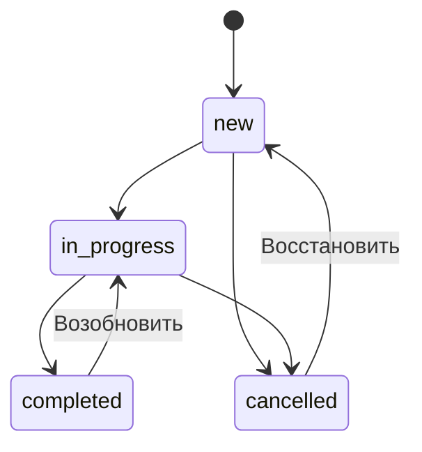
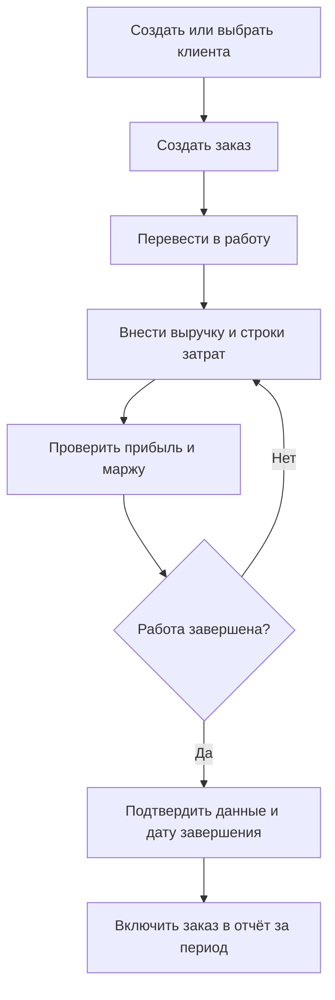
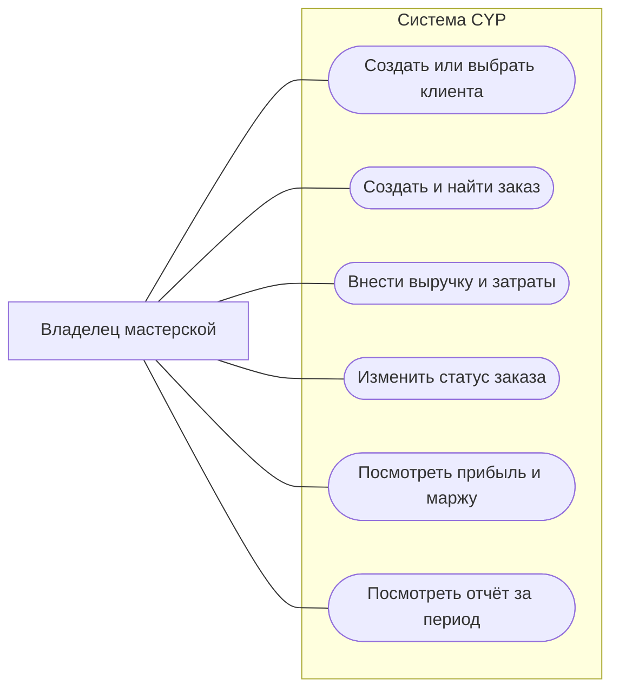
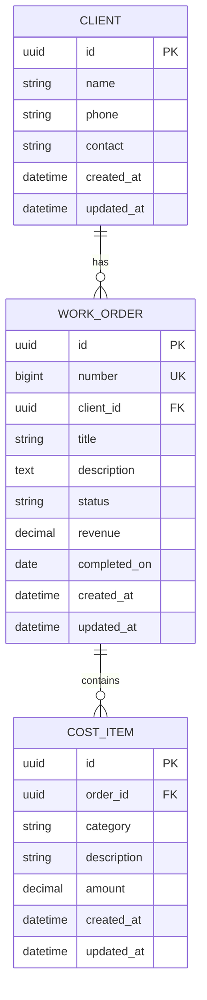
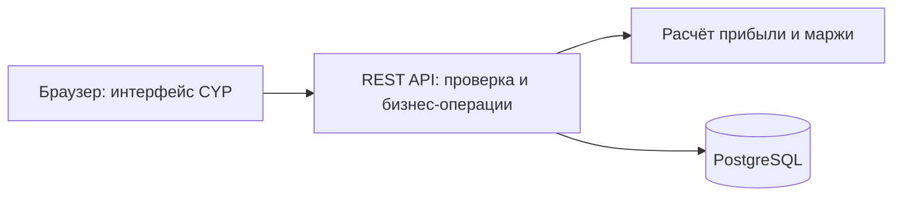

# CYP — Check Your Profit

Веб-приложение для управленческого учёта заказов мастерской. CYP помогает ответить на главный вопрос: **сколько мастерская заработала на каждом заказе с учётом материалов, труда и других расходов?**

По интерфейсу приложение напоминает мини-CRM: клиенты, заказы и статусы. Основной результат работы — расчёт прибыли и маржи по заказам, а не управление продажами.

> **Статус:** проектирование MVP. Этот README — исходная спецификация для разработки, а не описание уже реализованных функций. Код приложения и инструкции запуска пока отсутствуют.
>
> Требования MVP ниже служат рабочей основой. Предлагаемый стек и организация разработки выделены отдельно и должны быть подтверждены до реализации соответствующих компонентов. Изменения бизнес-правил необходимо сначала отразить в README вместе с контрольными примерами.

## Содержание

1. [Назначение и границы MVP](#1-назначение-и-границы-mvp)
2. [Функциональные требования](#2-функциональные-требования)
3. [Правила расчётов](#3-правила-расчётов)
4. [Статусы и бизнес-процесс](#4-статусы-и-бизнес-процесс)
5. [Сценарии использования](#5-сценарии-использования)
6. [Модель данных](#6-модель-данных)
7. [Интерфейс](#7-интерфейс)
8. [Отчёт по марже](#8-отчёт-по-марже)
9. [Архитектура и структура проекта](#9-архитектура-и-структура-проекта)
10. [Порядок разработки и критерии готовности](#10-порядок-разработки-и-критерии-готовности)
11. [Запуск и проверка](#11-запуск-и-проверка)
12. [Решения перед реализацией](#12-решения-перед-реализацией)

## 1. Назначение и границы MVP

**Пользователь:** владелец или управляющий мастерской, который вносит данные по заказам и оценивает их финансовый результат.

**Единица учёта:** отдельный заказ. У заказа есть клиент, статус, сумма выручки и строки затрат.

### Входит в MVP

- Список заказов с поиском и фильтром по статусу.
- Создание и редактирование заказа.
- Минимальная карточка клиента: имя, телефон и/или другой контакт.
- Ввод выручки и затрат по категориям: материалы, труд, доставка, прочее.
- Автоматический расчёт общей суммы затрат, прибыли и маржи.
- Отчёт по завершённым заказам за выбранный период.
- Сохранение данных между перезапусками приложения.

### За пределами MVP

- Воронка продаж, задачи, переписка, уведомления и маркетинг.
- Склад, остатки, закупки и списание материалов со склада.
- Табель, расчёт зарплаты и автоматический учёт часов.
- Учёт платежей, авансов, задолженности и движения денег.
- План-факт, сметы и отдельные версии бюджета заказа.
- Автоматическое распределение аренды, коммунальных и других общих расходов.
- Бухгалтерский и налоговый учёт, НДС, фискальные документы.
- Мультивалютность, интеграции, экспорт и импорт.
- Несколько мастерских, командные роли и совместное редактирование.

Рабочая граница MVP — одна мастерская и один оператор. Это не определяет способ авторизации: модель доступа и размещения нужно выбрать до сетевого развёртывания (раздел 12).

## 2. Функциональные требования

| ID | Функция | Требуемое поведение |
|---|---|---|
| F1 | Список заказов | Показывает номер, название, клиента, статус, выручку, затраты, прибыль и маржу; открывает карточку заказа |
| F2 | Создание заказа | Требует название и клиента; назначает уникальный номер, статус «Новый» и дату создания; выручка по умолчанию 0 |
| F3 | Редактирование | Позволяет менять название, описание, клиента и выручку; сохранение пересчитывает показатели |
| F4 | Учёт затрат | Позволяет добавлять, редактировать и удалять отдельные строки затрат с категорией, описанием и суммой |
| F5 | Статусы | Поддерживает переходы и даты завершения по разделу 4 |
| F6 | Клиенты | Позволяет создать, выбрать и изменить клиента; один клиент может иметь несколько заказов |
| F7 | Расчёты | Возвращает одинаковые показатели в карточке, списке и отчёте по правилам раздела 3 |
| F8 | Отчёт | Показывает завершённые за период заказы и общие показатели по разделу 8 |
| F9 | Поиск и фильтры | Ищет по номеру, названию заказа и имени клиента; поиск и фильтр статуса применяются совместно |
| F10 | Проверка данных | Отклоняет некорректные значения на сервере; интерфейс показывает ошибку у соответствующего поля |

Удаление заказа и клиента в MVP не предусмотрено: ошибочный заказ можно отменить. Удаление отдельной строки затрат требует подтверждения. Клиентские контакты не обязаны быть уникальными.

## 3. Правила расчётов

### 3.1. Термины

- **Выручка заказа (R)** — вручную внесённая стоимость выполненного заказа для клиента с учётом согласованных скидок. Для незавершённого заказа это текущая оценка выручки. Это не сумма полученных платежей.
- **Затраты заказа (C)** — сумма всех внесённых строк затрат, непосредственно отнесённых на заказ.
- **Прибыль по заказу (P)** — выручка за вычетом внесённых затрат.
- **Маржа (M)** — доля прибыли в выручке, выраженная в процентах.

В MVP показатель «Прибыль по заказу» не является чистой прибылью мастерской: общие расходы и налоги учитываются только в том случае, если пользователь самостоятельно включил их в затраты конкретного заказа. Приложение не распределяет их автоматически.

### 3.2. Формулы

```text
C = сумма всех строк затрат заказа
P = R − C
M = P / R × 100%, если R > 0
M = не определена, если R = 0
```

При нулевой выручке интерфейс показывает маржу как «—», API возвращает `null`. Прибыль при этом рассчитывается: например, при затратах 3 000 ₽ она равна −3 000 ₽. Убыток и отрицательная маржа допустимы. Отсутствие строк затрат означает затраты 0 ₽.

**Маржа и наценка — разные показатели.** CYP считает маржу от выручки. Наценка от себестоимости в MVP не рассчитывается.

### 3.3. Контрольный пример

| Показатель | Значение |
|---|---:|
| Выручка | 50 000,00 ₽ |
| Материалы | 20 000,00 ₽ |
| Труд | 15 000,00 ₽ |
| Доставка | 3 000,00 ₽ |
| Всего затрат | 38 000,00 ₽ |
| Прибыль по заказу | **12 000,00 ₽** |
| Маржа | **24,00%** |

Труд вводится готовой суммой. Умножение часов на ставку, начисление зарплаты и справочник сотрудников не входят в MVP. Материалы также вводятся суммой, без количества и цены за единицу. «Прочее» позволяет учесть дополнительные расходы, не расширяя категории.

### 3.4. Деньги, точность и валидация

- Единственная валюта — российский рубль. Суммы вводятся с точностью до копейки.
- Выручка — число от 0 до 999 999 999,99 ₽. Каждая строка затрат — число больше 0 и не больше 999 999 999,99 ₽.
- Денежные суммы передаются в API десятичными строками, например `"50000.00"`, и хранятся как точные десятичные значения. Расчёты денег через двоичные `float` запрещены.
- Суммы с более чем двумя знаками после разделителя отклоняются, а не округляются незаметно. Интерфейс принимает запятую или точку как десятичный разделитель и нормализует ввод перед отправкой.
- Итоговые затраты и прибыль должны поддерживать суммы, превышающие ограничение одной строки; переполнение недопустимо.
- Маржа рассчитывается без промежуточного округления; результат округляется до двух знаков по правилу `ROUND_HALF_UP`. Отрицательный ноль отображается как `0,00%`.
- Отрицательные выручка и затраты, пустая обязательная сумма, `NaN`, бесконечность и неизвестная категория отклоняются. Возвраты и корректировки отдельными отрицательными проводками не поддерживаются.
- Пользователь исправляет исходную сумму или строку затрат; после сохранения все зависящие показатели обновляются.
- Расчёт на сервере — источник истины. Предварительный расчёт в форме допустим, но после сохранения интерфейс использует ответ сервера.
- Расчётные итоги не редактируются вручную и не хранятся как независимые от исходных данных значения.

## 4. Статусы и бизнес-процесс

| Код | Название | Смысл |
|---|---|---|
| `new` | Новый | Заказ создан, работа ещё не начата |
| `in_progress` | В работе | Выполняются работы и вносятся затраты |
| `completed` | Завершён | Работа завершена, внесены актуальные выручка и затраты |
| `cancelled` | Отменён | Заказ не выполнен; данные сохраняются |

Допустимые переходы:



- Перевод в «Завершён» требует даты завершения. Интерфейс предлагает текущую дату, пользователь может указать другую в диапазоне от даты создания до текущей даты включительно.
- Нулевая выручка и отсутствие затрат не блокируют завершение: бесплатные заказы допустимы. Перед завершением интерфейс показывает суммы и просит подтвердить их актуальность.
- При возобновлении завершённого заказа дата завершения очищается, заказ исключается из отчёта. Повторное завершение требует новой даты.
- Отмена не обнуляет выручку и затраты. Отменённые заказы доступны в списке, но исключены из основного отчёта.
- Финансовые данные можно исправить и в завершённом заказе. Отчёт пересчитывается по текущим данным; закрытых периодов, истории изменений и зафиксированных отчётных снимков в MVP нет.
- Дату завершения завершённого заказа можно исправить в том же допустимом диапазоне; это меняет его принадлежность отчётному периоду.
- Все остальные переходы статусов сервер отклоняет. Статус не означает оплату клиентом.



Это схема основного процесса в Mermaid, а не формальная BPMN-диаграмма. Возможность отмены и восстановления отражена в диаграмме статусов.

## 5. Сценарии использования



Диаграмма показывает пользовательские возможности без формальных UML-связей `include` и `extend`.

| ID | Сценарий | Ожидаемый результат |
|---|---|---|
| UC-1 | Пользователь создаёт клиента и заказ | Заказ появляется в списке со статусом «Новый»; клиент доступен для повторного выбора |
| UC-2 | Вносит 50 000 ₽ выручки и три расхода из примера | Карточка и список показывают 38 000 ₽ затрат, 12 000 ₽ прибыли, 24% маржи |
| UC-3 | Меняет стоимость материалов с 20 000 на 22 000 ₽ | Затраты становятся 40 000 ₽, прибыль 10 000 ₽, маржа 20% |
| UC-4 | Завершает заказ с выбранной датой | Заказ попадает в отчёт за период, включающий эту дату |
| UC-5 | Возобновляет завершённый заказ | Заказ возвращается в работу и исчезает из отчёта |
| UC-6 | Открывает отчёт без завершённых заказов за период | Видит пустой список, нулевые суммы и «—» вместо общей маржи |

## 6. Модель данных

Логическая схема MVP. Имена полей задают общий словарь; физическая схема и миграции должны соблюдать перечисленные ограничения.



### Клиент (`Client`)

- `name`: обязательное имя или название, 1–200 символов после удаления пробелов по краям.
- `phone`: необязательный телефон, до 50 символов; хранится строкой с сохранением `+` и форматирования.
- `contact`: необязательный другой контакт — email, мессенджер или текст, до 200 символов.
- Хотя бы одно из полей `phone` и `contact` должно быть непустым. Проверка существования телефона или адреса не выполняется.
- Изменение клиента обновляет его данные во всех связанных заказах. Исторический снимок контактов не хранится.

### Заказ (`WorkOrder`)

- `id`: внутренний UUID; `number`: отдельный уникальный положительный номер для пользователя, назначается сервером, не редактируется и не переиспользуется. Непрерывность нумерации не гарантируется.
- `client_id`: обязательная ссылка на существующего клиента.
- `title`: обязательное название, 1–200 символов после удаления пробелов по краям.
- `description`: необязательное описание, до 5 000 символов.
- `status`: одно из четырёх значений раздела 4; по умолчанию `new`.
- `revenue`: обязательная точная сумма, по умолчанию 0.
- `completed_on`: календарная дата, заполнена только при `completed`; для остальных статусов — `null`.

### Строка затрат (`CostItem`)

- Принадлежит ровно одному заказу; перенос между заказами в MVP не предусмотрен.
- `category`: `materials` — материалы, `labor` — труд, `delivery` — доставка, `other` — прочее.
- `description`: обязательное пояснение, 1–500 символов после удаления пробелов по краям, например «Фанера» или «Сборка».
- `amount`: обязательная положительная сумма. Несколько строк одной категории допустимы.
- Самостоятельной даты расхода нет: отчёт группирует заказы по дате завершения, а не расходы по дате оплаты.

### Общие ограничения

- `created_at` и `updated_at` назначает сервер; время хранится в UTC. Изменение затрат обновляет также `updated_at` заказа.
- Для календарных границ используется единый часовой пояс мастерской; исходное значение — `Europe/Moscow`. `completed_on` хранится как дата без часового пояса.
- Связи защищены внешними ключами; создание затрат для несуществующего заказа запрещено.
- Проверки сумм, статусов и согласованности даты завершения обеспечиваются сервером и, где применимо, ограничениями БД.
- Прибыль, маржа и общие затраты вычисляются из выручки и строк затрат.

## 7. Интерфейс

Язык MVP — русский. Основные разделы навигации: **«Заказы»**, **«Клиенты»**, **«Отчёт»**. Экраны ниже — текстовые макеты, не утверждённый визуальный дизайн.

### 7.1. Список заказов

```text
CYP                         Заказы | Клиенты | Отчёт

Заказы                                 [+ Новый заказ]
[Поиск по номеру, названию или клиенту] [Статус: Все]

№ | Заказ | Клиент | Статус | Выручка | Затраты | Прибыль | Маржа
1 | Стол  | Иван   | В работе | 50 000 | 38 000  | 12 000  | 24,00%
```

По умолчанию видны все статусы, сортировка — по дате создания от новых к старым, при равенстве — по номеру от большего к меньшему. Поиск — по подстроке без учёта регистра; пробелы по краям запроса удаляются. Должны различаться состояния «заказов ещё нет» и «по запросу ничего не найдено».

### 7.2. Карточка заказа

```text
Заказ №1 — Стол                         [Статус: В работе]
Клиент: Иван · +7 …                     [Изменить заказ]

Выручка       Затраты       Прибыль       Маржа
50 000 ₽      38 000 ₽      12 000 ₽      24,00%

Затраты                                      [+ Добавить]
Категория | Описание       | Сумма       | Действия
Материалы | Фанера         | 20 000 ₽    | Изменить / Удалить
Труд      | Сборка         | 15 000 ₽    | Изменить / Удалить
Доставка  | Доставка       |  3 000 ₽    | Изменить / Удалить
```

- Выручка меняется через явную форму редактирования, затраты — отдельными строками.
- У незавершённого заказа показатели подписываются как предварительные.
- Убыток обозначается знаком минус и текстом; цвет не должен быть единственным способом обозначения результата.
- Несохранённые изменения не включаются в показатели других экранов и отчёта.
- После успешного изменения связанные представления обновляются без ручной перезагрузки страницы.

### 7.3. Клиенты

Список показывает имя и контакты, поддерживает создание и редактирование. В карточке клиента отображаются контакты и его заказы со ссылками на карточки. Аналитика по клиенту, заметки и история общения не входят в MVP.

### 7.4. Общие состояния

Для каждого экрана нужны загрузка, пустое состояние и ошибка с возможностью повторить запрос. При ошибке сохранения форма сохраняет введённые данные и не сообщает об успехе. Во время отправки повторное нажатие кнопки сохранения блокируется. Интерфейс должен оставаться пригодным для работы на узком экране: таблица может иметь горизонтальную прокрутку, формы и основные показатели должны помещаться по ширине.

## 8. Отчёт по марже

**Назначение:** оценить результат завершённых заказов за период.

### Выборка

- Пользователь выбирает начальную и конечную календарные даты, обе границы включаются. Начальная дата не может быть позже конечной.
- По умолчанию выбран текущий календарный месяц в часовом поясе мастерской.
- В выборку входят только заказы со статусом `completed`, у которых `completed_on` попадает в период.
- Новый заказ, заказ в работе и отменённый заказ исключаются независимо от внесённых сумм.
- Затраты включаются целиком вместе с заказом. Даты создания строк затрат не влияют на период.
- Таблица содержит номер, название, клиента, дату завершения, выручку, затраты, прибыль и маржу каждого заказа. Сортировка: дата завершения по убыванию, затем номер по убыванию.

### Общие показатели

```text
Количество заказов = число заказов в выборке
Общая выручка = сумма R по выборке
Общие затраты = сумма C по выборке
Общая прибыль = общая выручка − общие затраты
Общая маржа = общая прибыль / общая выручка × 100%
```

**Общая маржа не равна среднему арифметическому маржи заказов.** Если заказ A принёс 12 000 ₽ прибыли при выручке 50 000 ₽, а заказ B — 5 000 ₽ при выручке 10 000 ₽, общая маржа составляет `17 000 / 60 000 × 100 = 28,33%`, а не `(24% + 50%) / 2 = 37%`.

Заказы с нулевой выручкой входят в количество заказов, затраты и прибыль. При нулевой общей выручке общая маржа равна `null` и отображается как «—». При пустой выборке количество и денежные суммы равны нулю. Итоги считаются по всей выборке, даже если таблица будет разбита на страницы.

Отчёт отражает текущие данные и может измениться после исправления или возобновления заказа. Он не является отчётом о движении денег или бухгалтерской отчётностью.

## 9. Архитектура и структура проекта

### Предлагаемый стек

Следующий стек предложен по аналогии с [DebtFree](https://github.com/NE4EL/DebtFree), но пока не реализован и не зафиксирован файлами зависимостей:

| Слой | Предложение | Назначение |
|---|---|---|
| Frontend | React + TypeScript + Vite | Формы, таблицы, навигация |
| Backend | Python + FastAPI + Pydantic | API, проверка данных, расчёты |
| Доступ к БД | SQLAlchemy + Alembic | Модели и версионирование схемы |
| База данных | PostgreSQL | Постоянное хранение и ограничения целостности |
| Проверки | pytest; инструменты frontend уточняются | Расчёты, API, ключевые пользовательские сценарии |
| Развёртывание | Docker Compose + nginx | Воспроизводимый запуск сервисов |

Версии и зависимости выбираются при инициализации компонентов и закрепляются в соответствующих файлах проекта. Само наличие технологии в таблице не означает наличие готовой инфраструктуры.



Сервер выполняет изменения атомарно и возвращает расчётные показатели. Отчёт получает строки и общие суммы из согласованного состояния данных. Контракт API необходимо описать до параллельной реализации клиента и сервера: маршруты, поля, денежные строки, `null` для маржи, ошибки и правила обновления.

### Планируемая структура

Это целевая организация, а не перечень существующих файлов:

```text
CYP/
├── backend/
│   ├── app/
│   │   ├── api/           # HTTP-маршруты
│   │   ├── models/        # модели хранения
│   │   ├── schemas/       # входные и выходные данные
│   │   ├── services/      # операции с заказами и отчётами
│   │   └── core/          # точные расчёты и бизнес-правила
│   ├── migrations/        # миграции БД
│   └── tests/             # расчёты, API, интеграционные проверки
├── frontend/
│   └── src/
│       ├── components/    # общие элементы интерфейса
│       ├── pages/         # заказы, клиенты, отчёт
│       └── api/           # клиент API и типы
├── docs/                  # последующие решения и контракт API
├── docker-compose.yml     # после реализации инфраструктуры
├── .env.example           # только примеры, без секретов
└── README.md
```

## 10. Порядок разработки и критерии готовности

### Этапы

1. Уточнить решения раздела 12; согласовать стек, размещение и контракт API.
2. Реализовать модель данных, миграции и расчётный модуль; проверить денежные правила на контрольных примерах.
3. Реализовать клиентов, заказы, затраты и переходы статусов через API.
4. Реализовать список, карточки и формы с серверной обработкой ошибок.
5. Реализовать отчёт, фильтры периода и общие показатели.
6. Проверить сквозные сценарии, сохранность данных и запуск с чистого окружения; добавить фактические команды запуска.

### Контрольные проверки

| ID | Проверка | Ожидаемый результат |
|---|---|---|
| T1 | Основной пример: R = 50 000; C = 20 000 + 15 000 + 3 000 | C = 38 000; P = 12 000; M = 24,00% |
| T2 | R = 10 000; C = 12 000 | P = −2 000; M = −20,00% |
| T3 | R = 0; C = 3 000 | P = −3 000; M = null / «—» |
| T4 | R = 1 000; строк затрат нет | C = 0; P = 1 000; M = 100,00% |
| T5 | R = 100; C = 100 | P = 0; M = 0,00% |
| T6 | R = 0,30; C = 0,10 + 0,20 | C = 0,30; P = 0,00; M = 0,00% без погрешности float |
| T7 | R = 32; C = 31 | P = 1; M = 3,13% по ROUND_HALF_UP |
| T8 | Два заказа из примера общей маржи | R = 60 000; P = 17 000; M = 28,33% |
| T9 | В отчёт входят заказ R = 1 000, C = 0 и заказ R = 0, C = 200 | Количество = 2; P = 800; M = 80,00% |
| T10 | Завершённые заказы на обеих границах периода; за пределами — ещё один | Включены обе границы, внешний заказ исключён |
| T11 | В периоде есть заказы всех четырёх статусов | В отчёте только завершённые; отменённые затраты не исчезают из карточки |
| T12 | Возобновление и повторное завершение | Дата очищается, затем задаётся заново; выборка отчёта обновляется |
| T13 | Исправление выручки, изменение и удаление затрат завершённого заказа | Карточка, список и отчёт дают одинаковые обновлённые суммы |
| T14 | Пустая выборка / только заказы с нулевой выручкой | Общая маржа «—»; остальные итоги соответствуют исходным данным |
| T15 | Отрицательная сумма, лишняя точность, неизвестный статус или категория, несуществующий ID связанной записи | Сервер отклоняет операцию без частичного сохранения |
| T16 | Сохранение и перезапуск приложения | Клиенты, заказы, затраты и даты сохраняются |
| T17 | Ошибка сервера при сохранении формы | Нет ложного сообщения об успехе, ввод пользователя сохранён |

### MVP готов, когда

- Реализованы F1–F10, проходят контрольные проверки T1–T17 и сквозные сценарии UC-1–UC-6.
- Создание заказа, добавление затрат, завершение и просмотр отчёта выполняются через интерфейс без ручного редактирования БД.
- Расчёты одинаковы во всех представлениях; точность денег и правила общей маржи подтверждены автоматическими тестами.
- Миграции создают схему на пустой БД; данные переживают перезапуск сервисов.
- В README приведены проверенные команды запуска и тестов, необходимые переменные окружения и адреса сервисов.
- Секреты и реальные контакты клиентов не попадают в репозиторий; демонстрационные данные вымышлены.
- Выбранная модель доступа реализована до размещения приложения в сети.

## 11. Запуск и проверка

**Приложение пока нельзя запустить:** в репозитории нет реализованных frontend, backend, миграций и конфигурации окружения. Команды из DebtFree нельзя считать инструкцией запуска CYP.

После появления рабочего приложения этот раздел должен содержать:

1. Проверенные версии необходимых инструментов.
2. Подготовку `.env` из `.env.example` с описанием каждой переменной.
3. Запуск БД и применение миграций.
4. Запуск backend и frontend либо Docker Compose.
5. Адрес интерфейса и документации API.
6. Команды автоматических тестов и подготовки отдельной тестовой БД.
7. Остановку и повторный запуск с сохранением данных; отдельно — явно обозначенную процедуру сброса тестового окружения.

До этого момента статус проекта остаётся «проектирование / разработка», а будущие возможности не описываются как уже работающие.

## 12. Решения перед реализацией

Пользовательское описание определяет цель продукта и основной состав MVP. Для однозначной разработки этот README дополнительно предлагает конкретные правила: категории затрат, переходы статусов, отчёт по дате завершения, возможность исправлять завершённые заказы и одного оператора. Эти правила являются рабочими допущениями и требуют проверки владельцем продукта до реализации соответствующей логики.

| Решение | Рабочее предложение | Когда нужно определить |
|---|---|---|
| Технологический стек | Стек из раздела 9 | Перед инициализацией проекта |
| Доступ и размещение | Один оператор; локальное использование или защищённый сервер | Перед реализацией доступа и сетевым развёртыванием |
| Основа отчёта | Завершённые заказы по дате завершения, текущие суммы | Перед реализацией отчёта |
| Статусы и исправления | Переходы раздела 4, завершённые заказы можно исправлять | Перед реализацией операций с заказом |
| Общие расходы | Только ручное отнесение конкретной суммы на заказ | Перед реализацией затрат |
| Резервное копирование | Способ, место хранения и восстановление определяются под размещение | До ввода реальных данных |

Если решение меняется, нужно обновить связанные требования, модель данных и контрольные проверки в одном изменении. Расширение за пределы MVP оформляется отдельно, чтобы основной сценарий — **заказ → выручка и затраты → прибыль и маржа → отчёт** — оставался первым результатом разработки.
